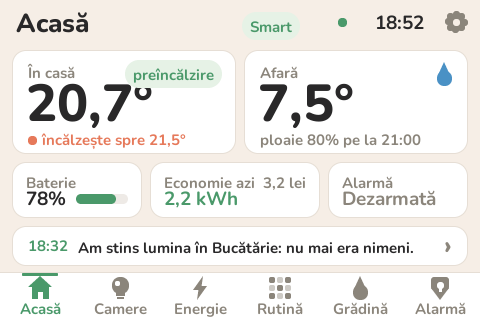
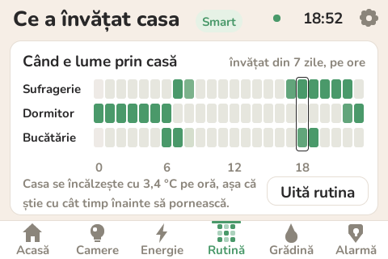
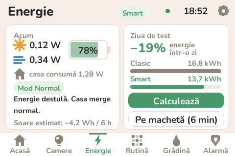

# NEPHA — casa care se gândește singură cum să economisească energie

Proiectul nostru pentru **Competiția Națională Arduino 2026** (tema „Inovație Smart Energy”).

NEPHA e o casă cu trei camere și o grădină, condusă de un Arduino Uno. Are un panou cu ecran
tactil pe perete, o placă separată în grădină și o aplicație de telefon (Android și iPhone),
dar partea importantă nu se vede: **Arduino ia singur deciziile care economisesc energie** și
spune de fiecare dată *de ce* a făcut ce a făcut.

**Ce e real și ce e calculat.** Montate și legate avem: lumina din dormitor (două întrerupătoare
Livolo, comandate prin radio), senzorul de temperatură și umiditate DHT11, senzorii wireless de pe
uși și geamuri cu alarma și sirena, placa din grădină cu senzorul de ploaie și cele 3 electrovalve
pe relee, panoul cu ecran și aplicația. Restul casei e **virtual**, calculat de Arduino cu un model
simplu: temperatura din celelalte două camere, becurile din sufragerie și bucătărie, caloriferul,
priza TV, soarele, vântul și bateria. Deciziile sunt aceleași ca într-o casă adevărată, iar
energia e socotită pentru o casă adevărată.

<p>
  
  
</p>

*(capturi din simulatorul ecranului; pozele cu montajul adevărat le punem în [docs/imagini](docs/imagini))*

## De la ce am pornit

Într-o casă obișnuită se pierde energie în moduri pe care nici nu le mai observăm:

- încălzirea merge la fel de tare și când nu e nimeni acasă, și noaptea;
- deschidem geamul să aerisim, iar caloriferul încearcă să încălzească strada;
- luminile rămân aprinse în camerele din care am plecat;
- televizorul „stins” stă în standby zi și noapte și tot consumă;
- programatorul udă grădina la prânz, chiar dacă peste trei ore plouă.

Ne-am întrebat ce ar face o casă care își observă locuitorii, vremea și bateria, și care
învață din ce vede. Asta e NEPHA.

## Ce face casa singură

| Situația | Ce face NEPHA | De unde știe |
|---|---|---|
| Plecați toți de acasă | lasă temperatura să scadă, stinge luminile (și Livolo), taie priza TV | alarma armată „Plecat” |
| Vă întoarceți de obicei pe la 17:30 | pornește încălzirea mai devreme, cât să fie cald când intrați | **rutina învățată** + cât de repede se încălzește casa (tot învățat) |
| Noaptea | trece pe temperatura de noapte, iar dimineața încălzește înainte să vă treziți | rutina |
| Deschideți un geam iarna | oprește încălzirea până se închide | senzorul de pe geam **sau** scăderea bruscă a temperaturii |
| Ieșiți dintr-o cameră* | stinge lumina după câteva minute (mai repede la orele când de obicei nu stați acolo) | senzorul de mișcare + rutina |
| Afară e încă destul de lumină* | aprinde becul doar cât lipsește | fotorezistența |
| TV-ul stă în standby și nu e nimeni acasă | taie priza; o pornește la loc când vine cineva | INA219 pe priză + alarma (sau mișcare) |
| Pământul e uscat, dar vine ploaia | nu udă | umiditatea solului + prognoza meteo |
| Plouă chiar acum | nu udă | senzorul de ploaie din grădină |
| Bateria e plină și panoul încă produce | pornește acum ce poate aștepta (udatul) | INA219 pe panou și baterie |
| Bateria scade și nu se produce nimic | lumini mai slabe, un grad mai puțin | INA219 + prognoza (dacă vine vreme înnorată, economisește de mai devreme) |

\* Programul le are, dar le pornim doar cu senzorii de mișcare și fotorezistența legate (`ARE_PIR`,
`ARE_LDR` în `casa/config.h`). Acum nu-i avem, așa că luminile le aprindeți voi, iar casa le
stinge când plecați; în ziua de test le vedem cu oamenii virtuali. E următoarea îmbunătățire.
La fel, priza TV, bateria și panoul solar sunt deocamdată virtuale (fără INA219, casa ghicește
când e televizorul pornit, după oră și după cine e acasă). Un panou solar avem deja; legarea lui
cu un INA219 e tot la „mai târziu”.

Și, pe lângă toate astea, **alarma**: senzori wireless pe uși și geamuri, armare de pe panou,
PIN, sirenă. Am legat-o de energie: când armați „Plecat”, casa știe *sigur* că e goală.
Dacă vede că nu e nimeni de o jumătate de oră și nu așteaptă pe nimeni curând, vă întreabă pe
panou dacă să armeze.

## Partea de „inteligență”

Am încercat să folosim lucruri simple, pe care le putem explica și care încap pe un Arduino Uno:

- **Rutina** — pentru fiecare cameră și fiecare oră, casa numără în câte zile a fost cineva acolo.
  Probabilitatea e `(zile cu cineva + 1) / (zile observate + 2)` (regula lui Laplace: fără date
  dă 50%, adică „nu știu”). Zilele vechi contează tot mai puțin, ca să țină pasul cu un program nou.
- **Preîncălzirea** — casa știe cu câte grade pe oră se încălzește (învață asta de fiecare dată când
  merge caloriferul), așa că pornește exact cât e nevoie înainte să vină cineva.
- **Fereastra deschisă** — compară temperatura de acum cu media ultimelor ~5 minute. Dacă e cu
  peste 0,5 °C mai jos, aproape sigur e un geam deschis (merge și în camerele fără senzor pe geam).
- **Standby-ul** — după consumul de pe priză deosebește un televizor pornit de unul în standby.
- **Prognoza** — panoul ia de pe internet (open-meteo.com) ploaia și soarele din următoarele ore;
  casa nu udă înainte de ploaie și își păstrează bateria dacă vine vreme înnorată.
- **Panoul solar** — panoul ESP32 compară ce produce panoul nostru cu cât soare spune prognoza că
  este și învață un „factor” al panoului, cu care estimează producția din următoarele ore.

## Dovada: aceeași zi, de două ori

Ca să vedem cât contează toate astea, casa poate trăi **ziua de test**: o zi de octombrie cu o
familie care se trezește la 6:30, pleacă la 8, se întoarce la 17:30 și se culcă la 22:30, cu
2 °C dimineața, 13 °C la prânz și ploaie între 16 și 18. O trăiește o dată ca o casă clasică și
o dată ca NEPHA. Aceeași familie, aceeași vreme — diferența vine doar din decizii.

Rezultatul (comanda `TEST RAPID`, energie socotită pentru o casă adevărată):

| | Casă clasică | NEPHA | Economie |
|---|---:|---:|---:|
| Încălzire | 16,2 kWh | 13,3 kWh | 18% |
| Lumini | 177 Wh | 91 Wh | 49% |
| Priza TV (standby) | 397 Wh | 257 Wh | 35% |
| Udare | 60 Wh | 0 Wh | 100% |
| **Total pe zi** | **16,8 kWh** | **13,7 kWh** | **19%** |
| Apă la udat | 80 l | 0 l | |

Adică ~3 kWh pe zi, ~4 lei pe zi la 1,40 lei/kWh, în sezonul rece. Cifrele vin din modelul casei
(o familie virtuală, aceeași vreme), nu dintr-o măsurătoare pe o casă adevărată. Aceeași zi se
poate trăi și în ~6 minute (`TEST CLASIC`, apoi `TEST SMART`): atunci lumina din dormitor (Livolo)
și udatul lucrează de-adevăratelea, după oamenii virtuali. Cu un INA219 legat, casa ar măsura și
consumul real.



## Cum e făcută

```
 (pentru mai târziu:                              ┌─ DHT11 (temperatură + umiditate)
  panou solar, turbină,                           ├─ receptor 433 MHz (uși, geamuri)
  baterie, INA219)                                ├─ (opțional) PIR, fotorezistență
                                                  │
                    ┌──────────────────┐          │
                    │   Arduino Uno    │◄─────────┘
                    │ "creierul" casei │──► emițător 433 MHz → întrerupătoarele Livolo, sirenă
                    └────────┬─────────┘    (virtual: becuri, încălzire, pompă, priza TV)
                             │ I2C (A4/A5)
                    ┌────────▼─────────┐
                    │ ESP32 + ecran 3,5"│──► Wi-Fi: oră, prognoză, pagina web, aplicația
                    │     (panoul)      │
                    └────────┬─────────┘
                             │ ESP-NOW (radio direct, fără router)
                    ┌────────▼─────────┐
                    │ ESP32-S3 grădină │──► senzor de ploaie, 3 electrovalve (relee)
                    └──────────────────┘
```

**Arduino Uno e creierul**: citește toți senzorii, ține minte rutina în EEPROM și ia toate
deciziile. **Panoul ESP32** (placa ESP32-3248S035 cu ecran tactil de 3,5") arată ce se întâmplă,
trimite comenzile noastre și aduce de pe internet ora și prognoza. Dacă panoul se strică, casa
merge mai departe; dacă se strică Arduino, panoul nu mai are ce arăta. Așa am vrut.

Pe telefon, panoul servește pagina casei la `http://nepha.local` (sau la IP-ul scris în Setări).
Dacă nu are Wi-Fi, face el o rețea, `NEPHA-casa`.

## Ce e în repo

| Folder | Ce găsiți |
|---|---|
| [`casa/`](casa) | programul pentru Arduino Uno — fiecare parte în tab-ul ei (alarmă, termostat, lumini, energie, grădină, rutină...) |
| [`panou/`](panou) | programul pentru panoul ESP32: ecranele, Wi-Fi, prognoza, pagina web |
| [`gradina/`](gradina) | programul pentru placa din grădină (ESP32-S3): senzorul de ploaie și zonele de udat |
| [`web/`](web) | pagina casei (un singur fișier HTML; se poate deschide și direct în browser, atunci arată o zi demo) |
| [`aplicatie/`](aplicatie) | aplicația de telefon (Flutter, Android și iPhone): aceleași ecrane ca pagina casei, plus un mod demo |
| [`simulare/`](simulare) | casa virtuală (tot proiectul, în browser) și schema pentru simulatorul Wokwi |
| [`docs/`](docs) | [montajul](docs/montaj.md), [piesele](docs/piese.md), [mesajele dintre plăci](docs/protocol.md), [cum funcționează codul](docs/cum-functioneaza-codul.md) |
| [`unelte/`](unelte) | scripturile cu care am făcut fonturile cu diacritice pentru ecran și am pus pagina în panou |

## Cum îl urcăm pe plăci

Avem nevoie de Arduino IDE 2.

**Arduino Uno** (`casa/casa.ino`)
1. Library Manager: instalăm `rc-switch` (și `OneWire`, doar pentru senzori DS18B20).
2. Placa: *Arduino Uno*. Upload.
3. Serial Monitor la 115200, cu „Newline”. Scriem `STARE`, `SCAN` sau `TEST RAPID`.

**Panoul** (`panou/panou.ino`)
1. Boards Manager: `esp32` (Espressif). Library Manager: `LovyanGFX`, `ArduinoJson`, `PubSubClient`.
2. Placa: *ESP32 Dev Module*, Partition Scheme: **Huge APP (3MB No OTA/1MB SPIFFS)**. Upload.
3. La prima pornire ecranul cere calibrarea: atingem vârful fiecărei săgeți.
4. Telefonul pe rețeaua `NEPHA-casa` (parola `casa2026`), apoi `http://192.168.4.1/wifi` ca să-i
   dăm rețeaua casei.

**Placa din grădină** (`gradina/gradina.ino`)
1. Placa: *ESP32S3 Dev Module*. Upload. Nu are nevoie de biblioteci.
2. Pornește singură și caută panoul (pe Serial: „Am găsit panoul, pe canalul …”).

Legăturile dintre plăci și senzori sunt în [docs/montaj.md](docs/montaj.md).

## Simulare

Tot proiectul se poate încerca fără nicio componentă: deschideți
[`simulare/casa-virtuala.html`](simulare/casa-virtuala.html) în browser. Acolo rulează codul
adevărat al ambelor plăci: ecranul panoului se atinge cu mouse-ul, macheta se aprinde, iar
senzorii sunt butoane. (Casa virtuală e construită pe 25 octombrie: nu are încă DHT11, Livolo și
placa din grădină.) Programul pentru Arduino merge și singur în [Wokwi](https://wokwi.com).
Detalii în [simulare/README.md](simulare/README.md).

## Echipa

- David Stan
- Mihai Mandragiu
- Daria Stan
- Profesor coordonator: Carmen Mincă

Colegiul Național de Informatică „Tudor Vianu”, București.

Codul e liber de folosit ([MIT](LICENSE)); fontul Nunito de pe ecran are licența lui
([OFL](panou/LICENTA-Nunito.txt)).
