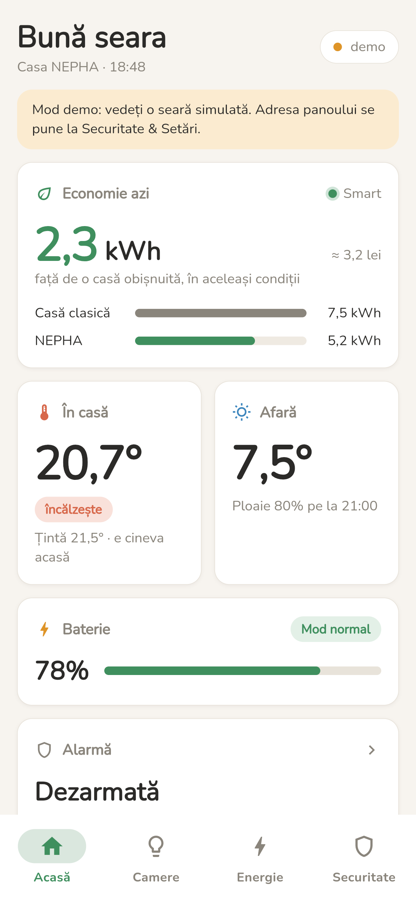
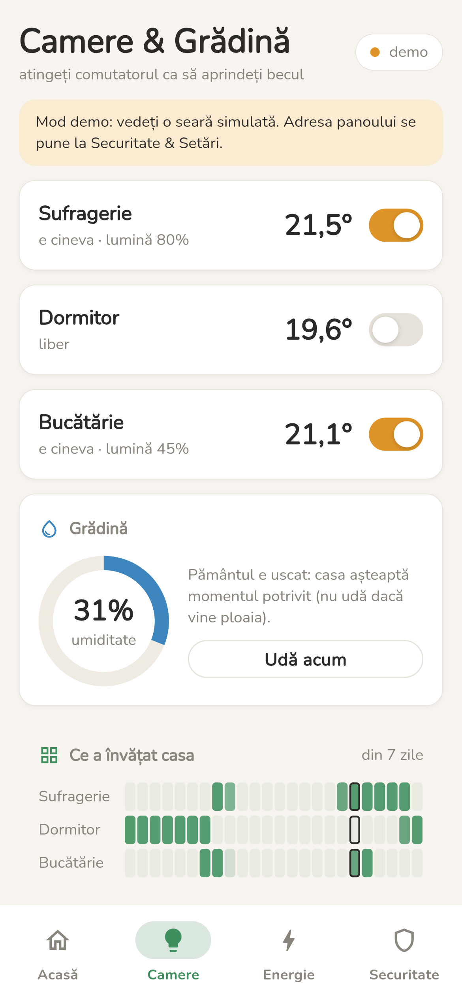
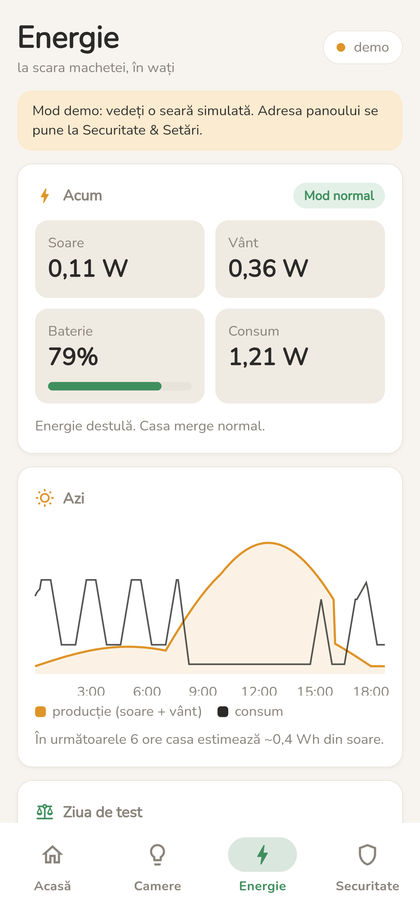
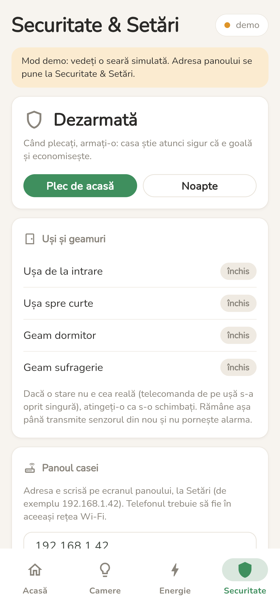

# NEPHA — aplicația de telefon (Flutter)

Aceeași casă ca pe panou și pe pagina casei, dar ca aplicație pentru Android și iPhone. Aplicația nu
ia nicio decizie: doar arată ce face casa și trimite comenzile noastre, prin panoul ESP32. Creierul
rămâne Arduino.

<p>
  
  
  
  
</p>

Patru file:

- **Acasă** — economia de azi (kWh și lei, față de o casă clasică), în casă / afară, bateria,
  alarma și jurnalul deciziilor casei;
- **Camere & Grădină** — luminile (se aprind de aici), umiditatea solului cu „Udă acum” și ce a
  învățat casa (pe camere și pe ore);
- **Energie** — soarele, vântul, bateria și consumul, graficul zilei și ziua de test (clasic vs smart);
- **Securitate & Setări** — alarma (PIN sau amprentă), ușile și geamurile, adresa panoului, modul
  demo, Smart / Clasic și temperatura de confort.

## Cum o pornim

Avem nevoie de [Flutter](https://docs.flutter.dev/get-started/install) și, pentru Android, de
**Android Studio** (aduce Android SDK-ul). Telefonul se leagă cu cablu USB, cu *USB debugging* pornit.

```
cd aplicatie
flutter pub get
flutter run
```

Fără telefon, se poate încerca și pe calculator: `flutter run -d windows` (merge și cu panoul
adevărat) sau `flutter run -d chrome` (în browser doar modul demo: panoul nu permite cereri din
pagini străine).

## Cum o legăm de casă

1. Telefonul în aceeași rețea Wi-Fi cu panoul (sau în rețeaua panoului, `NEPHA-casa`, parola `casa2026`).
2. Pe panou, la **Setări**, scrie adresa lui (de exemplu `192.168.1.42`; în rețeaua `NEPHA-casa` e
   `192.168.4.1`).
3. În aplicație, la **Securitate & Setări**: scriem adresa, apăsăm **Conectează**.

Sus, în dreapta, se vede legătura: verde = conectat, galben = se conectează sau Arduino nu răspunde,
roșu = panoul nu răspunde. Fără panou, **modul demo** arată o seară simulată (e pornit la prima
deschidere), iar comenzile merg și acolo.

## Alarma și amprenta

PIN-ul îl verifică Arduino, nu aplicația. Prima dată dezarmăm cu PIN-ul; dacă Arduino l-a acceptat și
„Dezarmare cu amprenta” e pornită, aplicația îl păstrează criptat pe telefon. Data viitoare ajunge
amprenta (sau Face ID): aplicația trimite ea PIN-ul.

## Cum e făcută

- Vorbește cu panoul exact ca pagina casei: `GET /api/stare` la 2 secunde, `POST /api/comanda`
  (vezi [docs/protocol.md](../docs/protocol.md) și [panou/web.ino](../panou/web.ino)).
- Dacă panoul nu răspunde în 3 secunde, renunțăm și scriem „Panoul nu a putut fi contactat”.
- Comutatoarele se mută pe loc și așteaptă confirmarea; dacă nu vine, revin.
- Panoul vorbește HTTP simplu (fără HTTPS): pe Android e permis în `AndroidManifest.xml`
  (`usesCleartextTraffic`), pe iPhone în `Info.plist` (doar rețeaua locală).
- Fontul Nunito e în aplicație (`assets/google_fonts`), merge și fără internet.

| Fișier | Ce face |
|---|---|
| `lib/models/api_models.dart` | ce trimite panoul (aceleași câmpuri ca în `panou/web.ino`) |
| `lib/services/api_service.dart` | cererile către panou (dio, 3 s) și seara simulată pentru modul demo |
| `lib/providers/app_state.dart` | starea aplicației: întrebările periodice, comenzile, setările, amprenta |
| `lib/theme/nepha_theme.dart` | culorile și fontul (aceleași ca pe pagină și pe panou) |
| `lib/widgets/` | cardurile, comutatoarele, graficul, harta rutinei, tastatura PIN |
| `lib/screens/` | cele patru ecrane |

Înainte de a urca modificări: `flutter analyze` și `flutter test`.
